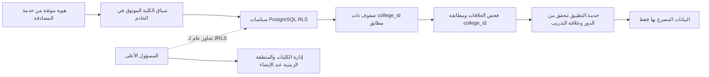

# ERD — مخطط علاقات البيانات

**المصدر التفصيلي للحقول والقيود:** [`database.dbml`](./database.dbml)  
**قرارات النطاق:** PostgreSQL، RLS، `college_id` للجداول التشغيلية، حجز المقاعد عند اعتماد الكلية النهائي فقط، ووقت الحضور بحسب `colleges.timezone`.

## 1. مخطط الكيانات والعلاقات

```mermaid
erDiagram
    COLLEGES ||--o{ USERS : contains
    COLLEGES o|--o{ USER_ROLES : scopes
    USERS ||--o{ USER_ROLES : assigned
    ROLES ||--o{ USER_ROLES : grants
    USERS ||--o{ USERS : approves_activation

    COLLEGES ||--o{ SPECIALTIES : owns
    SPECIALTIES ||--|| SPECIALTY_TRAINING_REQUIREMENTS : configures
    COLLEGES ||--o{ SPECIALTY_TRAINING_REQUIREMENTS : scopes

    COLLEGES ||--o{ TRAINING_OPPORTUNITIES : owns
    USERS ||--o{ TRAINING_OPPORTUNITIES : creates
    TRAINING_OPPORTUNITIES ||--o{ OPPORTUNITY_SPECIALTIES : targets
    SPECIALTIES ||--o{ OPPORTUNITY_SPECIALTIES : targeted_by
    TRAINING_OPPORTUNITIES ||--o{ OPPORTUNITY_SITES : uses
    TRAINING_SITES ||--o{ OPPORTUNITY_SITES : attached_to
    COLLEGES ||--o{ TRAINING_SITES : owns

    USERS ||--o{ FILE_ASSETS : uploads
    COLLEGES ||--o{ FILE_ASSETS : scopes
    TRAINING_OPPORTUNITIES ||--o{ TRAINING_APPLICATIONS : receives
    USERS ||--o{ TRAINING_APPLICATIONS : applies
    FILE_ASSETS o|--o{ TRAINING_APPLICATIONS : resume
    COLLEGES ||--o{ TRAINING_APPLICATIONS : scopes
    TRAINING_APPLICATIONS ||--o{ APPLICATION_STATUS_HISTORY : transitions
    USERS o|--o{ APPLICATION_STATUS_HISTORY : changes

    TRAINING_APPLICATIONS ||--o| TRAININGS : becomes
    USERS ||--o{ TRAININGS : student
    USERS ||--o{ TRAININGS : academic_supervisor
    TRAINING_OPPORTUNITIES ||--o{ TRAININGS : placement
    SPECIALTIES ||--o{ TRAININGS : specialty_snapshot
    COLLEGES ||--o{ TRAININGS : scopes
    TRAININGS ||--o{ TRAINING_SUPERVISOR_ASSIGNMENTS : supervisor_history
    USERS ||--o{ TRAINING_SUPERVISOR_ASSIGNMENTS : assigned_supervisor
    USERS ||--o{ TRAINING_SUPERVISOR_ASSIGNMENTS : assigns

    TRAININGS ||--o{ ATTENDANCE_RECORDS : attendance
    TRAINING_SITES o|--o{ ATTENDANCE_RECORDS : check_in_site
    TRAINING_SITES o|--o{ ATTENDANCE_RECORDS : check_out_site
    USERS o|--o{ ATTENDANCE_RECORDS : company_review
    ATTENDANCE_RECORDS o|--o{ ATTENDANCE_CHANGE_REQUESTS : correction_requests
    TRAININGS ||--o{ ATTENDANCE_CHANGE_REQUESTS : relates_to
    USERS ||--o{ ATTENDANCE_CHANGE_REQUESTS : requests
    USERS o|--o{ ATTENDANCE_CHANGE_REQUESTS : decides

    TRAININGS ||--o{ SUPERVISOR_NOTES : notes
    USERS ||--o{ SUPERVISOR_NOTES : authors
    SUPERVISOR_NOTES ||--o{ SUPERVISOR_NOTE_REVISIONS : revisions
    USERS ||--o{ SUPERVISOR_NOTE_REVISIONS : edits

    TRAININGS ||--o| FINAL_EVALUATIONS : final_evaluation
    USERS ||--o{ FINAL_EVALUATIONS : submits
    FINAL_EVALUATIONS ||--|{ EVALUATION_ITEMS : has_items
    EVALUATION_CRITERIA ||--o{ EVALUATION_ITEMS : rated_by

    TRAININGS ||--o{ CONVERSATIONS : conversations
    CONVERSATIONS ||--|{ CONVERSATION_PARTICIPANTS : participants
    USERS ||--o{ CONVERSATION_PARTICIPANTS : participates
    CONVERSATIONS ||--o{ MESSAGES : contains
    USERS ||--o{ MESSAGES : sends

    TRAININGS ||--o{ DISPUTE_REPORTS : disputes
    USERS ||--o{ DISPUTE_REPORTS : reports
    USERS o|--o{ DISPUTE_REPORTS : college_decides
    TRAININGS ||--o{ OFFICIAL_REQUESTS : requests
    USERS ||--o{ OFFICIAL_REQUESTS : submits
    USERS o|--o{ OFFICIAL_REQUESTS : decides
    OFFICIAL_REQUESTS ||--o{ OFFICIAL_REQUEST_FILES : attachments
    FILE_ASSETS ||--o{ OFFICIAL_REQUEST_FILES : attached_file

    COLLEGES ||--o{ NOTIFICATIONS : scopes
    USERS ||--o{ NOTIFICATIONS : receives
    COLLEGES o|--o{ AUDIT_LOGS : scopes
    USERS o|--o{ AUDIT_LOGS : acts
```

## 2. قراءة العلاقات الأساسية

- الكلية هي جذر العزل للبيانات. للجداول التشغيلية `college_id` إلزامي؛ يستخدم `NULL` فقط في مواضع الإدارة المركزية المحددة مثل مسؤول النظام وسجلات إدارة الكلية.
- الطالب يختار تخصصًا داخل كليته، ويقدم طلبات على فرص الكلية التي تستهدف تخصصه. كل طلب يحتفظ بسجل انتقالات مستقل.
- قبول مسؤول الشركة لا يحجز المقعد. المقعد يحجز فقط عند الاعتماد النهائي من مسؤول الكلية، ولا تدخل الطلبات المنتظرة أو المرفوضة في عدد المقاعد المحجوزة.
- الطلب المعتمد ينشئ تدريبًا واحدًا، يرتبط بسجل إسناد المشرف، وسجلات الحضور، وملاحظات المشرف، والتقييم النهائي.
- سجل الحضور اليومي يرتبط بموقع معتمد للحضور أو الانصراف. يحسب التاريخ المحلي من المنطقة الزمنية الإلزامية للكلية، مع بقاء التوقيتات المخزنة UTC.
- التصحيح/الاستثناء سجل مستقل مربوط بالحضور والتدريب، ويراجعه مسؤول جهة التدريب.
- ملاحظات المشرف لها سجل تغييرات منفصل؛ مسؤول الكلية يقرأ ولا يعدل، ولا يراها الطالب أو جهة التدريب.
- التقييم النهائي واحد لكل تدريب، ويتكون من بنود تقييم حسب المعايير الستة المعتمدة.
- كل محادثة مرتبطة بتدريب وبمشاركين اثنين فقط؛ الرسائل نصية بلا مرفقات. الاطلاع الاستثنائي لمسؤول الكلية لا يتم إلا مع بلاغ نزاع أو طلب رسمي قائم وتوثيق السبب في سجل التدقيق.
- سجل التدقيق إلحاقي، ويحتوي على هوية الفاعل والوقت والسبب عند الاطلاع الاستثنائي.

## 3. مخطط العزل متعدد الكليات

كل إجراء يمر عبر التحقق من هوية المستخدم، ثم نطاق `college_id`، ثم الدور وعلاقة المستخدم بالسجل (طالب/مشرف/مسؤول شركة/مسؤول كلية). يجب اختبار محاولات الوصول العابرة للكليات على مستوى RLS والخادم معًا.

## 4. مفاتيح نطاق المستأجر

لتقوية سلامة العلاقات العابرة للجداول، يوصى بتعريف قيد فريد على (`college_id`, `id`) في كل جدول رئيسي نطاقي، ثم استخدام مفاتيح أجنبية مركبة تشمل `college_id` في الجداول التابعة. يوضح ملف DBML العلاقات المفاهيمية؛ تنفيذ RLS ومركبات المفاتيح/القيود الإضافية يكون في PostgreSQL migrations.

**ملاحظة:** هذا ERD وصف منطقي مطابق لمخطط DBML؛ لا يمثل سياسات RLS بوصفها علاقات ER، ويجب تطبيقها كسياسات PostgreSQL منفصلة.
