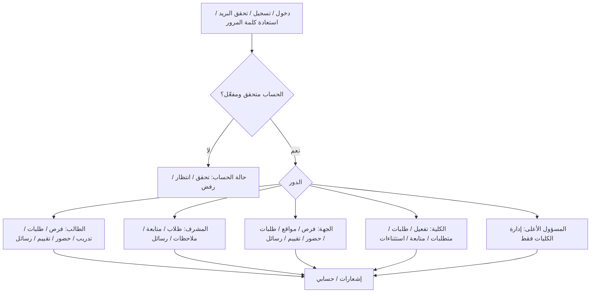
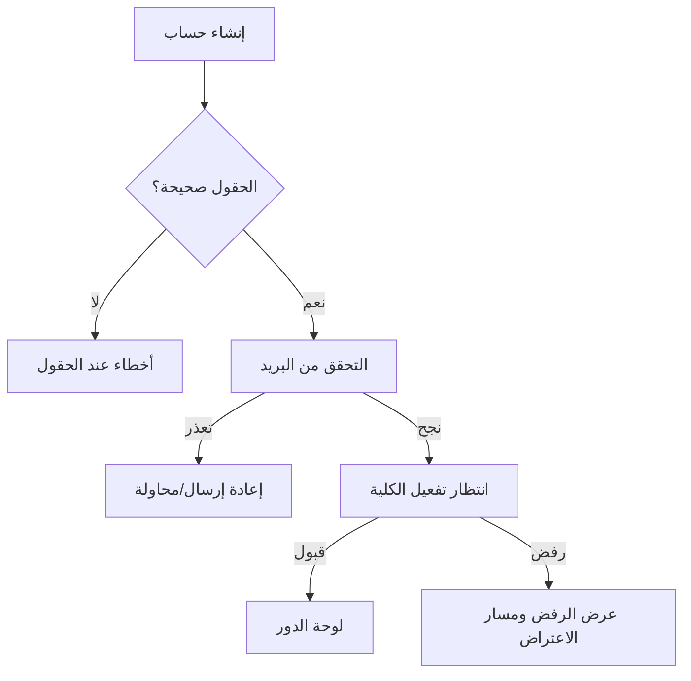
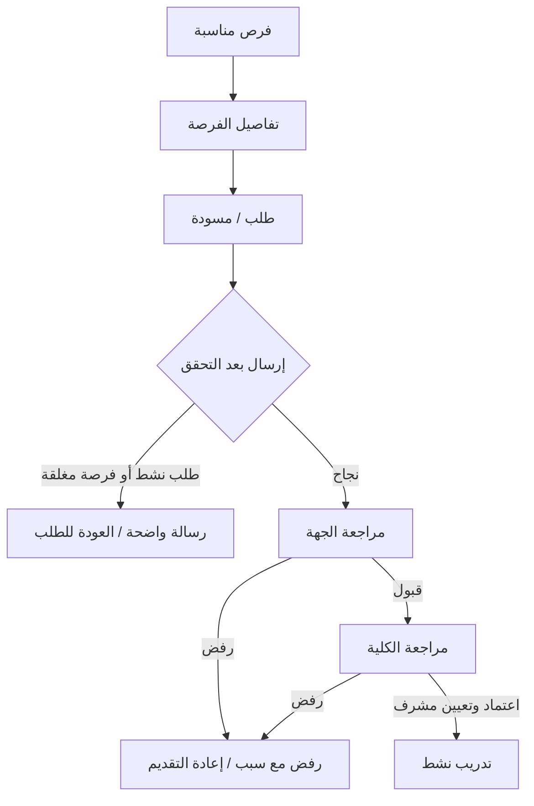
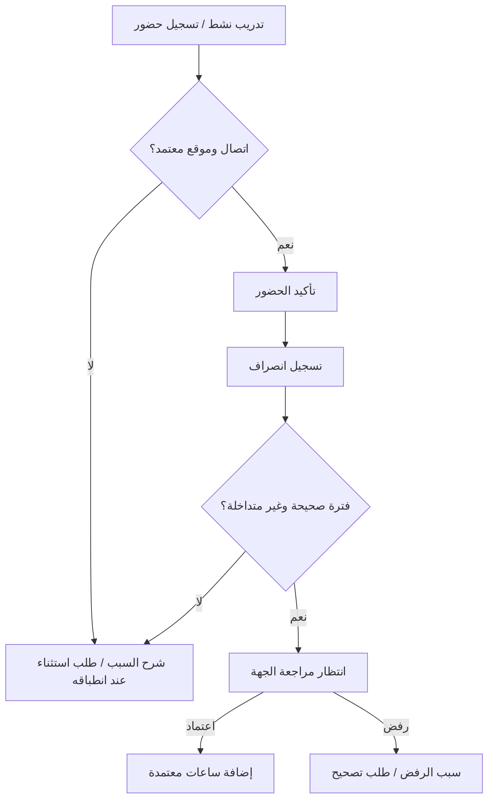

# مخطط تجربة المستخدم (UX Blueprint) — الخطوة 19

**المنتج:** نظام إدارة التدريب الميداني الجامعي  
**النطاق:** MVP فقط | **اللغة:** العربية RTL | **الحالة:** وثيقة تخطيط، لا تصميم شاشات ولا كود  
**المراجع الحاكمة:** `PRD.md`، `docs/UI_UX_REQUIREMENTS.md`، `docs/user-flow.md`؛ ويُراجع `docs/SCREEN_INVENTORY.md` مع هذا المخطط.  
**ملاحظة:** المسارات أدناه أسماء URL **مقترحة للتنظيم** وليست API أو قرارًا تقنيًا نهائيًا. لا تُحوَّل الخيارات غير المحسومة إلى متطلبات معتمدة.

## 1. خريطة الموقع والمسارات (MVP Sitemap)

- **عامة:** `/login` تسجيل الدخول، `/register` التسجيل، `/verify-email` التحقق من البريد، `/forgot-password` و`/reset-password` الاستعادة، `/account-status` انتظار التفعيل/الرفض.
- **مشتركة بعد التفعيل:** `/dashboard` لوحة حسب الدور، `/notifications` الإشعارات، `/profile` الحساب.
- **الطالب:** `/student/opportunities`، `/student/opportunities/:id`، `/student/applications`، `/student/applications/:id` (المسودة/التقديم/الخط الزمني)، `/student/training`، `/student/attendance`، `/student/attendance/requests`، `/student/evaluation`، `/student/official-requests`، `/student/messages`.
- **المشرف الأكاديمي:** `/supervisor/students`، `/supervisor/students/:id`، `/supervisor/notes`، `/supervisor/messages`.
- **مسؤول جهة التدريب:** `/company/opportunities`، `/company/opportunities/new`، `/company/opportunities/:id`، `/company/sites`، `/company/applications`، `/company/applications/:id`، `/company/attendance`، `/company/attendance/:id`، `/company/evaluations`، `/company/evaluations/:trainingId`، `/company/official-requests`، `/company/messages`.
- **مسؤول الكلية:** `/college/activations`، `/college/applications`، `/college/applications/:id`، `/college/specialties`، `/college/requirements`، `/college/supervisors`، `/college/sites`، `/college/trainings`، `/college/trainings/:id`، `/college/evaluations`، `/college/official-requests`، `/college/exceptions`، `/college/messages/access`.
- **المسؤول الأعلى:** `/admin/colleges`، `/admin/colleges/new`، `/admin/colleges/:id`. لا تُعرض له بيانات تدريب أو محادثات أو تقييمات افتراضيًا.

**قواعد التنقل:** قائمة جانبية يمينًا على الحاسوب وقائمة قابلة للطي في الهاتف؛ شريط علوي للحساب والإشعارات؛ عنوان الصفحة ومسار رجوع واضح؛ صفحات تفاصيل مستقلة؛ إخفاء الإجراءات غير المصرح بها مع **فرض التفويض من الخادم** وعزل بيانات الكليات.

## 2. رحلات المستخدم المكتملة (End-to-End MVP Journeys)

### J01 — التسجيل والتحقق والتفعيل (طالب / مشرف / مسؤول جهة)
1. التسجيل بالاسم الأول والأخير والبريد وكلمة المرور والكلية؛ الطالب يضيف الرقم الجامعي والتخصص، ومسؤول الجهة اسم الشركة؛ الهاتف اختياري.
2. تحقق الحقول وكلمة المرور (8 خانات على الأقل)؛ إنشاء حساب غير مفعّل؛ إرسال رسالة تحقق البريد.
3. تأكيد البريد ثم حالة «بانتظار موافقة مسؤول الكلية»؛ يتحقق المسؤول من بيانات الطالب وانتمائه ورقمه الجامعي وتخصصه قبل القرار.
4. قبول ⇒ دخول إلى لوحة الدور؛ رفض ⇒ حالة وسبب/مسار اعتراض وفق القواعد المعتمدة؛ انقطاع الشبكة ⇒ إعادة المحاولة دون ادعاء إتمام العملية.
5. استعادة كلمة المرور وقفل الدخول 15 دقيقة بعد 5 محاولات فاشلة مساران مساندان.

### J02 — الطالب: اكتشاف فرصة وطلب واعتماد
1. عرض فرص الكلية والتخصص المتاحة، ثم تفاصيل الفرصة ومواقعها المعتمدة ومتطلبات التدريب.
2. إنشاء طلب وحفظه مسودة قابلة للتعديل؛ لا يسمح بأكثر من طلب نشط واحد. يمكن إلغاء الطلب النشط قبل الاعتماد النهائي.
3. إرسال الطلب ⇒ «بانتظار رد جهة التدريب»؛ الجهة تقبل أو ترفض مع سبب؛ القبول ينقل الطلب إلى الكلية.
4. مسؤول الكلية يراجع المتطلبات ويعتمد نهائيًا مع تعيين مشرف أكاديمي أو يرفض مع سبب؛ **حجز المقعد عند اعتماد الكلية فقط**.
5. الطالب يرى خطًا زمنيًا للحالات والأسباب؛ بعد الرفض يمكن إعادة التقديم وفق شروط الأهلية وعدم وجود طلب نشط.

### J03 — الجهة: إنشاء فرصة ومواقع ومراجعة الطلب
1. إنشاء فرصة بالحقول المطلوبة في PRD وربط التخصصات والفترة والمقاعد؛ إضافة مواقع التدريب.
2. المواقع الجديدة بحالة انتظار حتى يعتمدها مسؤول الكلية ويحدد نطاق GPS لكل موقع؛ لا تُستخدم المواقع غير المعتمدة في إثبات الحضور.
3. فتح قائمة طلبات الجهة، مراجعة التفاصيل والسيرة الذاتية إن وجدت، قبول أو رفض مع سبب؛ لا حجز مقعد في هذه المرحلة.
4. حالة نجاح مؤكدة وتحديث قائمة الطلبات؛ إذا تغيرت أهلية الفرصة أو امتلأت عند اعتماد الكلية، يعرض النظام نتيجة القرار الحقيقية.

### J04 — الحضور والانصراف والاعتماد والاستثناء
1. الطالب في تدريب نشط يفتح الحضور؛ يطلب إذن الموقع **وقت التسجيل فقط** مع دقة GPS؛ لا تتبع مستمر ولا تسجيل دون اتصال.
2. موقع معتمد ودقة مقبولة ⇒ تسجيل الحضور؛ ثم الانصراف عند نهاية الفترة؛ يمكن عدة فترات **غير متداخلة** في اليوم.
3. موقع خارج النطاق/دقة غير كافية/نسيان/مشكلة تقنية ⇒ طلب تصحيح أو استثناء مسبب وفق النوع المتاح؛ لا احتساب تلقائي.
4. مسؤول الجهة يراجع يوميًا، يقبل/يرفض مع السبب؛ تُحتسب فقط الدقائق المعتمدة مع حد التخصص اليومي. سجلات العطل تُوسم ويجري اعتمادها وفق القواعد.
5. لا انصراف ⇒ سجل غير مكتمل لا يُحتسب؛ أي تعديل بعد الاعتماد يمر بطلب تصحيح موثق ويحفظ التاريخ.

### J05 — المشرف: متابعة وملاحظات
- يرى فقط طلابه المسندين وحضورهم وساعاتهم المعتمدة؛ يفتح تفاصيل التدريب ويضيف ملاحظات أداء ويعدلها مع سجل نسخ.
- مسؤول الكلية يقرأ الملاحظات وسجل تعديلاتها دون تعديلها؛ لا يراها الطالب أو مسؤول الجهة.
- المشرف يطلع على التقييم النهائي بعد إرساله بحسب الصلاحيات.

### J06 — التقييم النهائي والإغلاق
- مسؤول الجهة يفتح تقييم تدريب مرتبط به، يحفظ **مسودة**، ثم يرسل **تقييمًا نهائيًا واحدًا** بستة معايير وصفية؛ التعليق إلزامي عند «يحتاج تحسين».
- بعد الإرسال يُقفل تعديل التقييم وتظهر حالة الاستلام؛ الطالب والمشرف والكلية يرون ما تسمح به أدوارهم.
- الإغلاق الطبيعي يرتبط باستيفاء المتطلبات والتقييم؛ إذا تعذر التقييم، يظل **الاستثناء الموثق من الكلية** مسارًا منفصلًا، لا نجاحًا تلقائيًا.

### J07 — الطلبات الرسمية وإنهاء التدريب المبكر
- الطالب أو جهة التدريب يقدمان طلبًا رسميًا مسببًا؛ ويمكن لمسؤول الكلية بدء مسار رسمي موثق من جانبه.
- مسؤول الكلية يراجع الطلب والسبب ويتخذ قرارًا مسجلًا؛ إنهاء التدريب استثناء وليس إجراءً اعتياديًا.
- عند الإنهاء تُحفظ الساعات والسجلات السابقة، ولا تُعتبر الساعات مستوفاة تلقائيًا؛ تغيير المشرف يتم بطلب رسمي مع اعتماد وإسناد جديد.

### J08 — الرسائل والبلاغ والاطلاع الاستثنائي
- الأطراف المسموح لها تتبادل رسائل نصية ضمن تدريبها فقط، دون مرفقات.
- الاطلاع الاستثنائي لمسؤول الكلية على محادثة مشروط ببلاغ نزاع أو طلب رسمي قائم، مع تسجيل السبب والهوية والوقت قبل العرض.
- لا يوجد وصول افتراضي للمسؤول الأعلى إلى محادثات أو بيانات التدريبات.

### J09 — إدارة الكلية / المسؤول الأعلى
- مسؤول الكلية يدير التخصصات ومتطلبات الساعات والمدة والحد اليومي، تفعيل الحسابات، اعتماد المواقع، طلبات التدريب وتعيين المشرفين ومتابعة التقييمات والاستثناءات داخل كليته.
- المسؤول الأعلى يضيف الكليات ويدير بياناتها الأساسية ومنها المنطقة الزمنية؛ لا يطلع افتراضيًا على السجلات التشغيلية.

## 3. حالات الواجهة الأربعة — قواعد مشتركة

| الحالة | السلوك المطلوب | أمثلة نصية/إجراء |
|---|---|---|
| **Loading** | Skeleton للقوائم والبطاقات، مؤشر موضعي للأزرار، منع النقر المكرر؛ عدم نقل عناصر الصفحة فجأة | «جارٍ تحميل الفرص…»، «جارٍ إرسال الطلب…» |
| **Empty** | سبب واضح للفراغ، CTA حقيقي ومسموح بحسب الدور | «لا توجد فرص مناسبة حاليًا»؛ «عرض فرص التدريب» عندما ينطبق |
| **Error & Recovery** | تحقق بجانب الحقل؛ أخطاء اتصال/صلاحيات/تعارض مع إعادة المحاولة؛ الحفاظ على المدخلات غير الحساسة | «تعذر تحميل البيانات، حاول مجددًا»؛ «لم تعد الفرصة متاحة» |
| **Success** | تأكيد بعد استجابة الخادم فقط، حالة جديدة ورابط الخطوة التالية؛ لا نجاح وهمي | «أُرسل الطلب، وهو الآن بانتظار رد جهة التدريب» |

### مصفوفة الحالات حسب الرحلة

| الرحلة/الشاشة | التحميل | الفراغ | الخطأ والتعافي | النجاح |
|---|---|---|---|---|
| التسجيل والتفعيل | جلب الكليات/التخصصات | لا كليات أو تخصصات متاحة | حقول، بريد مستخدم، تحقق بريد، إعادة الإرسال | حساب منشأ / بريد مؤكد / حساب مفعل |
| الفرص | بطاقات Skeleton | لا فرص مناسبة | فشل الجلب/فرصة أغلقت؛ تحديث | عرض التفاصيل |
| الطلب والمسودة | تحميل التفاصيل/زر إرسال | لا طلبات؛ تصفح الفرص | طلب نشط، بيانات ناقصة، تعارض مقاعد | حفظ مسودة / إرسال / قرار موثق |
| الحضور | جلب التدريب/زر التسجيل | لا تدريب نشط أو لا سجلات | رفض GPS/انقطاع/تداخل؛ طلب استثناء | حضور أو انصراف مؤكد / اعتماد |
| متابعة المشرف | قائمة الطلاب | لا طلاب مسندين | فشل الجلب/حفظ الملاحظة | حفظ ملاحظة وسجل تغيير |
| إدارة الجهة | فرص/طلبات/مواقع | لا طلبات أو مواقع | حقول/موقع غير معتمد | فرصة محفوظة/قرار الجهة |
| التقييم | المعايير/زر إرسال | لا تدريب مؤهل للتقييم | معيار ناقص/تعليق إلزامي | مسودة محفوظة/تقييم مرسل |
| إدارة الكلية | قوائم انتظار | لا حسابات/طلبات معلقة | تعارض صلاحيات أو بيانات | تفعيل/اعتماد/قرار موثق |
| الرسائل والاستثناء | جلب المحادثة | لا محادثات متاحة | فشل الإرسال/عدم أهلية الوصول | إرسال رسالة/توثيق وصول |
| إدارة الكليات | قائمة الكليات | لا كليات | بيانات ناقصة/تكرار | إضافة/تحديث كلية |

**قاعدة هامة:** قد تكون حالة «الفراغ» غير منطبقة على شاشة تأكيد مفردة؛ لا نضيف شاشة أو رسالة بلا حاجة. تبقى الحالات الأربع إطار فحص لا أربع صفحات لكل شاشة.

## 4. مراجعات عابرة: Responsive & Accessibility

- **RTL:** العربية لغة الواجهة، محاذاة العناوين والحقول والقوائم لليمين، وعكس الأيقونات الاتجاهية فقط؛ تبقى الأرقام والبريد والتوقيت قابلة للقراءة.
- **Responsive:** فحص الهاتف (مثل 390 CSS px) والحاسوب (مثل 1440 CSS px) واللوحي؛ تتحول الجداول الكثيفة إلى بطاقات أو عرض مناسب دون إخفاء قرارات أو أسباب؛ القائمة الجانبية قابلة للطي على الهاتف. هذه **قيم فحص** لا نقاط توقف إلزامية.
- **Accessibility:** تباين النص العادي لا يقل عن 4.5:1 والكبير 3:1 عند القياس؛ تسمية حقول وأزرار، تنقل بلوحة المفاتيح، Focus ظاهر، رسائل أخطاء مرتبطة بالحقل، وعدم الاكتفاء باللون؛ حجم أهداف اللمس يُراجع بحسب المنصة والمعيار المستهدف.
- **في كل حالة:** تُعلن نتائج الإرسال/الخطأ للتقنيات المساعدة، ويحافظ التحميل على ترتيب التركيز، ولا يختفي إجراء التعافي في شاشة صغيرة.
- **خصوصية:** لا تُعرض بيانات كلية أخرى؛ لا يُستخدم الموقع إلا وقت الحضور/الانصراف؛ لا تُكشف تفاصيل داخلية في رسائل الأخطاء؛ لا يُعرض نجاح قبل تأكيد الخادم.

## 5. نطاق الأولوية

- **Core MVP:** التسجيل والتفعيل، الفرص والطلبات واعتمادها، إدارة المتطلبات، تعيين المشرف، مواقع التدريب، الحضور والاستثناءات والاعتماد، المتابعة، التقييم النهائي.
- **Supporting MVP:** الرسائل، الإشعارات، الطلبات الرسمية، سجل التدقيق والاطلاع الاستثنائي، إدارة الكليات، الحساب واستعادة كلمة المرور.
- **Future / خارج النطاق:** تتبع GPS المستمر، تسجيل الحضور دون اتصال، تقييمات مرحلية متعددة، دفع إلكتروني، ميزات تواصل غير منصوص عليها؛ لا تُصمم شاشات لها هنا.

## 6. قرارات مفتوحة لا تُحسم ضمن الخطوة 19

- تفاصيل تقنية بعينها لتنفيذ الخرائط وGIS، وشكل بعض التحققات والخدمات الخارجية؛ تُحسم في التنفيذ ولا تغير رحلة المستخدم المعتمدة.
- الصياغة النهائية لرسائل الاعتراض أو بعض الاستثناءات تعتمد على السياسة الموثقة، ولا تُفترض مهل أو صلاحيات جديدة.
- أسماء URL ومعرفات الشاشات هنا **اقتراح توثيقي**، لا التزام بمسارات كود قبل بدء تطوير الواجهة.

**معيار الاكتمال:** لكل رحلة أساسية مدخل ونتيجة وتفرعات رفض/تعافٍ؛ ولكل شاشة جرد في `docs/SCREEN_INVENTORY.md` يربط الدور والمسار والمكونات والبيانات والإجراءات والتحقق وحالات الواجهة. لا يتضمن هذا المستند Wireframes أو تصميمًا بصريًا نهائيًا أو كود واجهة.
