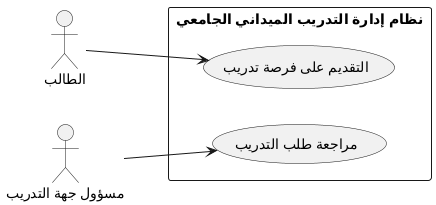

# PlantUML في مشروع نظام إدارة التدريب الميداني الجامعي

**الحالة:** مسودة. تشرح أداة PlantUML وتوثق طريقة المعاينة، وفيها عينة كود للتجربة.
**المخرجات:** `docs/diagrams/README-plantuml.md` (هذا الملف) و`docs/diagrams/plantuml-sample.puml`.

---

## 1. ما هي PlantUML ولماذا نستخدمها؟

PlantUML أداة مفتوحة المصدر تكتب المخططات بصيغة نصية (Diagrams as Code). في هذا المشروع نستخدمها لمخطط **حالات الاستخدام (Use Case)** فقط، وهو الموضوع 11. أما بقية المخططات فبصيغة Mermaid.

---

## 2. متى PlantUML ومتى Mermaid في هذا المشروع؟

| المخطط | الأداة | الملف |
|---|---|---|
| تدفق المستخدم (User Flow) | Mermaid | `docs/user-flow.md` |
| النموذج المفاهيمي (Domain Model) | Mermaid | `docs/diagrams/domain-model.md` |
| حالات الاستخدام (Use Case) | **PlantUML** | `docs/diagrams/use-case.puml` (الموضوع 11) |
| النشاط والحالات والتسلسل والكلاسات | Mermaid | `docs/diagrams/` |

---

## 3. الفرق بين PlantUML وMermaid

| وجه المقارنة | PlantUML | Mermaid |
|---|---|---|
| بداية الملف ونهايته | `@startuml` و`@enduml` | يبدأ بنوع المخطط، مثل `flowchart TD` |
| التصيير على GitHub | لا يُصيَّر تلقائياً داخل Markdown | يُصيَّر تلقائياً في Markdown |
| المحرر المناسب | PlantText أو خادم PlantUML الرسمي | Mermaid Live Editor |
| التوافق بين الأدوات | Mermaid Live لا يفهم صياغته | مصيّر PlantUML لا يفهم صياغته |

**قاعدة:** لا تخلط الصيغتين في كتلة كود واحدة.

---

## 4. المحررات المعتمدة

- **PlantText:** https://www.planttext.com/ للتجربة السريعة.
- **خادم PlantUML الرسمي:** https://www.plantuml.com/plantuml/uml/

---

## 5. عينة كود للتجربة

الملف: `docs/diagrams/plantuml-sample.puml`. العينة لتجربة الأداة فقط، وليست مخطط حالات الاستخدام المعتمد. تعتمد فقط على ما هو مؤكد في PRD: الطالب يقدّم الطلب، ومسؤول جهة التدريب يراجعه أولاً.

---

## 6. سجل المعاينة

يُملأ بعد التجربة الفعلية. لا يُكتب «نجح» دون تشغيل.

| المحرر | التاريخ | النتيجة |
|---|---|---|
| PlantText | | Not Run |
| خادم PlantUML الرسمي | | Not Run |

**كيف أجرّب:**
1. افتح PlantText والصق محتوى `plantuml-sample.puml`.
2. تأكد من ظهور الفاعلين وحدود النظام وحالتي الاستخدام.
3. غيّر النتيجة في الجدول أعلاه إلى Passed أو Failed مع ملاحظة قصيرة.

---

## 7. ما لا يثبته التصيير

- نجاح التصيير يعني أن الصياغة صحيحة فقط.
- لا يثبت أن الفاعلين وحالات الاستخدام والعلاقات تطابق المتطلبات.
- لا يجعل الرسم قراراً معتمداً؛ تُراجع المعاني مع PRD وuser-flow في الموضوع 11.

---

## 8. أخطاء شائعة

- لصق كود PlantUML في Mermaid Live (أو العكس).
- نسيان `@startuml` أو `@enduml`.
- استخدام `include` أو `extend` بلا مسوغ وظيفي صريح (يُراجَع في الموضوع 11).
