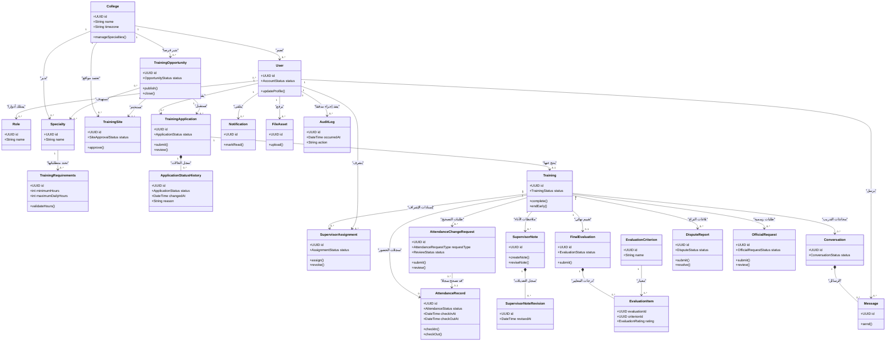

# مخطط الكلاسات — نظام إدارة التدريب الميداني الجامعي

يعرض هذا المخطط الكلاسات الأساسية وخصائصها وعملياتها المقترحة وعلاقاتها. أسماء الكلاسات والخصائص والدوال بالإنجليزية، وشرح العلاقات بالعربية.

## ملاحظات التصميم

- هذا Class Diagram منطقي للكلاسات الأساسية، وليس نسخا حرفيا لكل جدول في قاعدة البيانات.
- الجداول الوسيطة مثل `user_roles` و`opportunity_specialties` و`conversation_participants` ممثلة بعلاقات؛ التفاصيل المرجعية النهائية في `database.dbml`.
- العمليات المعروضة مقترحة وليست دوال منفذة.
- لكل تدريب تقييم نهائي واحد كحد أقصى؛ كل تقييم مرسل يحتوي على عناصر تقييم مرتبطة بالمعايير.
- طلب تصحيح الحضور قد لا يرتبط بسجل حضور سابق.
- الصلاحيات وعزل بيانات الكليات يخضعان لتصميم النظام وسياسات PostgreSQL RLS.
- طلب تغيير المشرف وتفعيل الحساب مفهومان مذكوران في النموذج المفاهيمي، لكن لا يظهران كجدولين مستقلين في مخطط DBML الحالي؛ يلزم حسم تمثيلهما قبل التنفيذ.