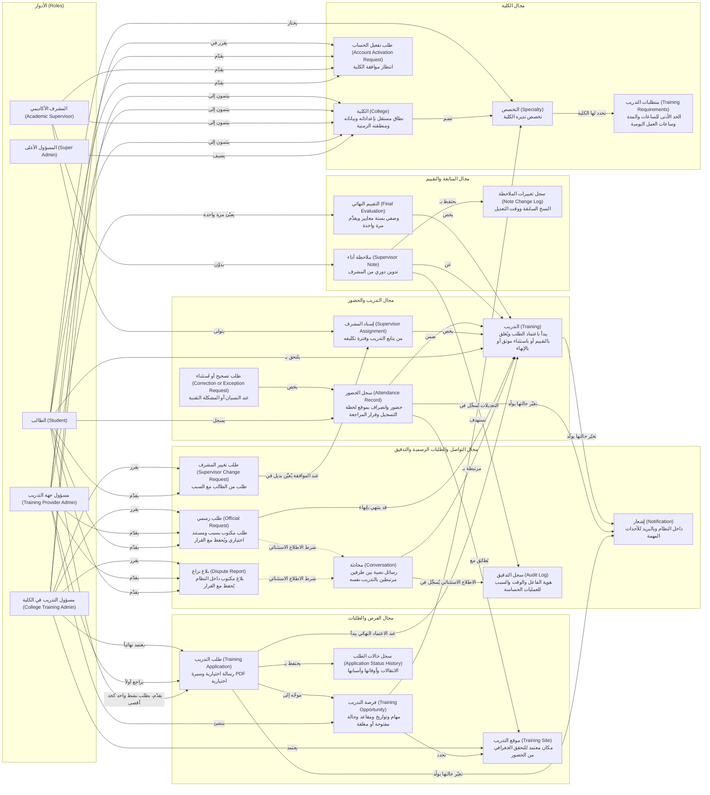

# النموذج المفاهيمي لمجال العمل: نظام إدارة التدريب الميداني الجامعي

**الحالة:** مسودة للمراجعة مع صاحب المشروع. نموذج مفاهيمي خالص (Mermaid `flowchart LR`)، وليس ERD ولا Class Diagram.
**المصادر:** `PRD.md` (المرجع الحاكم)، ثم `docs/user-flow.md`. استُعمل `docs/technical-design.md` للتأكد من اكتمال المفاهيم فقط، ولم يُنقل منه أي نوع بيانات أو مفتاح.
**المخرجات:** `docs/diagrams/domain-model.md` (هذا الملف) و`docs/diagrams/domain-model.mmd` (مصدر الرسم).

---

## 1. النموذج

**قراءة الرسم:** الأدوار في العمود الأيمن (في العرض العربي)، وكل مجال عمل في مربع مستقل. الخط المنقّط شرط، وليس علاقة تدفق مباشرة.

---

## 2. تعريف المفاهيم (مسؤولية كل مفهوم)

| المفهوم | مسؤوليته في جملة واحدة | المصدر |
|---|---|---|
| الكلية (College) | نطاق مستقل بإعداداته وبياناته وتخصصاته ومنطقته الزمنية. | PRD §4، §8 (قاعدة 1)، §7.1 |
| التخصص (Specialty) | برنامج تديره الكلية ويختاره الطالب لتُطبَّق عليه متطلبات تدريب مناسبة. | PRD §7.1 |
| متطلبات التدريب (Training Requirements) | الحد الأدنى لإجمالي الساعات ومدة التدريب وساعات العمل اليومية لكل تخصص. | PRD §7.1، §8 (قاعدة 6) |
| طلب تفعيل الحساب (Account Activation Request) | طلب ينتظر قرار مسؤول الكلية بعد تحقق البريد، ولا يُفعَّل الحساب قبله. | PRD §7.1، §8 (قاعدة 2) |
| فرصة التدريب (Training Opportunity) | عرض تنشئه جهة التدريب بمهام وتواريخ ومقاعد وحالة مفتوحة/مغلقة، موجّه لتخصصات الكلية. | PRD §7.2 |
| موقع التدريب (Training Site) | مكان تقترحه جهة التدريب وتعتمده الكلية، ويُستخدم للتحقق الجغرافي من الحضور. | PRD §7.3، §8 (قاعدة 14) |
| طلب التدريب (Training Application) | تقديم الطالب على فرصة، برسالة وسيرة PDF اختياريتين، ويمر بجهة التدريب ثم الكلية. | PRD §7.2، §10.1 |
| سجل حالات الطلب (Application Status History) | تاريخ انتقالات الطلب وأوقاتها وأسباب الرفض. | PRD §7.2، §10.1 |
| التدريب (Training) | الفترة التي تبدأ باعتماد الطلب نهائياً، وتُغلق بالتقييم أو باستثناء موثق أو بقرار إنهاء. | PRD §7.2، §7.4، §7.6 |
| إسناد المشرف (Supervisor Assignment) | ربط مشرف أكاديمي بالتدريب مع حفظ فترات التكليف السابقة. | PRD §7.2، §7.6 |
| سجل الحضور (Attendance Record) | حضور وانصراف يومي بموقع لحظة التسجيل وقرار مراجعة جهة التدريب. | PRD §7.3 |
| طلب تصحيح أو استثناء (Correction or Exception Request) | طلب من الطالب عند النسيان أو المشكلة التقنية، تراجعه جهة التدريب. | PRD §7.3، §8 (قاعدة 16) |
| ملاحظة أداء (Supervisor Note) | تدوين دوري من المشرف، لا تراها جهة التدريب ولا الطالب، وتُقرأ من الكلية فقط. | PRD §7.4، §8 (قاعدة 22) |
| سجل تغييرات الملاحظة (Note Change Log) | حفظ النسخة السابقة والجديدة ووقت التعديل. | PRD §7.4 |
| التقييم النهائي (Final Evaluation) | تقييم وصفي بستة معايير تقدمه جهة التدريب مرة واحدة، وهو شرط الإغلاق الطبيعي. | PRD §7.4، §8 (قاعدة 18) |
| محادثة (Conversation) | رسائل نصية خاصة بين طرفين مرتبطين بالتدريب نفسه، دون مرفقات. | PRD §7.5 |
| بلاغ نزاع (Dispute Report) | بلاغ مكتوب داخل النظام من أحد أطراف التدريب، يُحفظ مع قرار الكلية. | PRD §7.5 |
| طلب رسمي (Official Request) | طلب مكتوب بسبب ومستند اختياري، يُحفظ مع القرار (مثل إنهاء التدريب). | PRD §8 (قاعدة 21)، §7.6 |
| طلب تغيير المشرف (Supervisor Change Request) | طلب من الطالب بسبب، يراجعه مسؤول الكلية ويُعيّن البديل عند الموافقة. | PRD §7.6 |
| سجل التدقيق (Audit Log) | توثيق هوية الفاعل والوقت والسبب للعمليات الحساسة. | PRD §7.5 |
| إشعار (Notification) | تنبيه داخل النظام وبالبريد عند الأحداث المعتمدة المهمة. | PRD §7.5، §15 |

---

## 3. من يقرر ماذا (مختصر الأدوار)

هذه التفاصيل مأخوذة من الأدوار والصلاحيات في PRD §9، وأُخرجت من الرسم كي لا يتشابك.

| الدور | ما يفعله على المفاهيم أعلاه |
|---|---|
| المسؤول الأعلى | يضيف الكليات فقط. لا يطّلع افتراضياً على التدريبات أو المحادثات أو التقييمات. |
| مسؤول الكلية | يدير التخصصات ومتطلباتها، يوافق على الحسابات، يعتمد الطلب نهائياً، يعيّن المشرف، يعتمد المواقع الجديدة، يقرر في بلاغات النزاع والطلبات الرسمية وطلبات تغيير المشرف، ويقرأ ملاحظات المشرف دون تعديلها، ويطّلع استثنائياً على محادثة بسبب مسجّل. |
| مسؤول جهة التدريب | ينشئ الفرص ويضيف المواقع، يقبل الطلب أو يرفضه أولاً، يعتمد الحضور والتصحيحات يومياً، ويعبّئ التقييم النهائي مرة واحدة. |
| المشرف الأكاديمي | يتابع طلابه، يدوّن ملاحظات الأداء ويعدّلها، ويطّلع على الحضور والتقييم النهائي. |
| الطالب | يسجل ويختار تخصصه، يقدّم طلباً نشطاً واحداً، يسجل الحضور، يطلب التصحيح أو تغيير المشرف أو الإنهاء رسمياً، ويطّلع على تقييمه. |

---

## 4. التعددية المؤكدة فقط

لم تُرسم أي تعددية غير مذكورة في PRD. المؤكد منها:

- طلب نشط واحد لكل طالب (PRD §8، قاعدة 4).
- تقييم نهائي يُقدَّم مرة واحدة (قاعدة 18).
- محادثة بين طرفين اثنين مرتبطين بالتدريب نفسه (PRD §7.5).
- المشرف قد يتابع عدة طلاب (PRD §7.2).
- الفرصة تحدد موقعاً أو أكثر (PRD §7.2).

---

## 5. الالتزام بحدود المستوى المفاهيمي

- لا مفاتيح أساسية أو أجنبية (PK/FK).
- لا أنواع بيانات SQL أو برمجية.
- لا دوال ولا كلاسات؛ العلاقات أفعال أعمال (يقدّم، يعتمد، يتولى).
- لا حالات تشغيلية للتدريب، لأن PRD §10.3 يقول إن قائمتها غير معتمدة.

---

## 6. أسئلة مفتوحة وقرارات تحتاج مالك المجال

هذه النقاط لم تُحسم في المصادر، ولم أفترض لها جواباً:

1. **الشركة كمفهوم:** هل «جهة التدريب» مفهوم مستقل (بممثلين متعددين أو فروع) أم مجرد صفة لمسؤول الجهة (اسم الشركة)؟ لم أرسم «شركة» كمفهوم لهذا السبب. (PRD §17 رقم 12)
2. **أطراف المحادثة:** أي أزواج مسموح لها ببدء محادثة؟ رسمتُ الطالب والمشرف ومسؤول الجهة طرفاً محتملاً، والتحديد الدقيق غير محسوم. (user-flow §6 رقم 5)
3. **بلاغ النزاع:** هل يستطيع المشرف تقديمه؟ رسمتُ الطالب ومسؤول الجهة فقط، وفق user-flow.
4. **طلب تغيير المشرف والطلب الرسمي:** هل الأول نوع من الثاني (قاعدة 21)؟ PRD يعرّفهما بصيغتين منفصلتين، فرسمتهما منفصلين.
5. **حجز المقعد:** user-flow وtechnical-design يقرّان أن المقعد يُحجز عند اعتماد الكلية فقط، لكن PRD لا ينص على ذلك صراحة. لم أرسم مفهوم «مقعد/حجز»؛ هل يُرفع إلى PRD؟
6. **تعددية الطلب والتدريب والطالب:** هل يُنشئ الطلب المعتمد تدريباً واحداً، وهل يجوز للطالب أكثر من تدريب؟ غير مذكور في PRD، فلم أرسمها.
7. **السجلات التاريخية كمفاهيم:** اخترتُ تمثيل «سجل الحالات» و«سجل تغييرات الملاحظة» و«إسناد المشرف» كمفاهيم مستقلة لأن PRD يطلب حفظ تاريخها. إن رأى صاحب المجال أنها مجرد تاريخ داخل مفاهيمها فتُدمج.
8. **علاقة الطالب بالتدريب:** رسمتُ «يلتحق بـ» استنتاجاً من السياق، وليست عبارة صريحة في PRD؛ تحتاج تأكيداً.
9. **حالات التدريب:** لا قائمة معتمدة لها (PRD §10.3)، فلا تظهر في النموذج.

---

## 7. ملاحظات المراجعة

- اسأل نفسك: هل يستطيع صاحب المجال قراءة كل مربع وعلاقة دون أي مصطلح تقني؟
- بعد حسم الأسئلة أعلاه، يُحدَّث هذا النموذج قبل الانتقال إلى الموضوع 10 (PlantUML).
