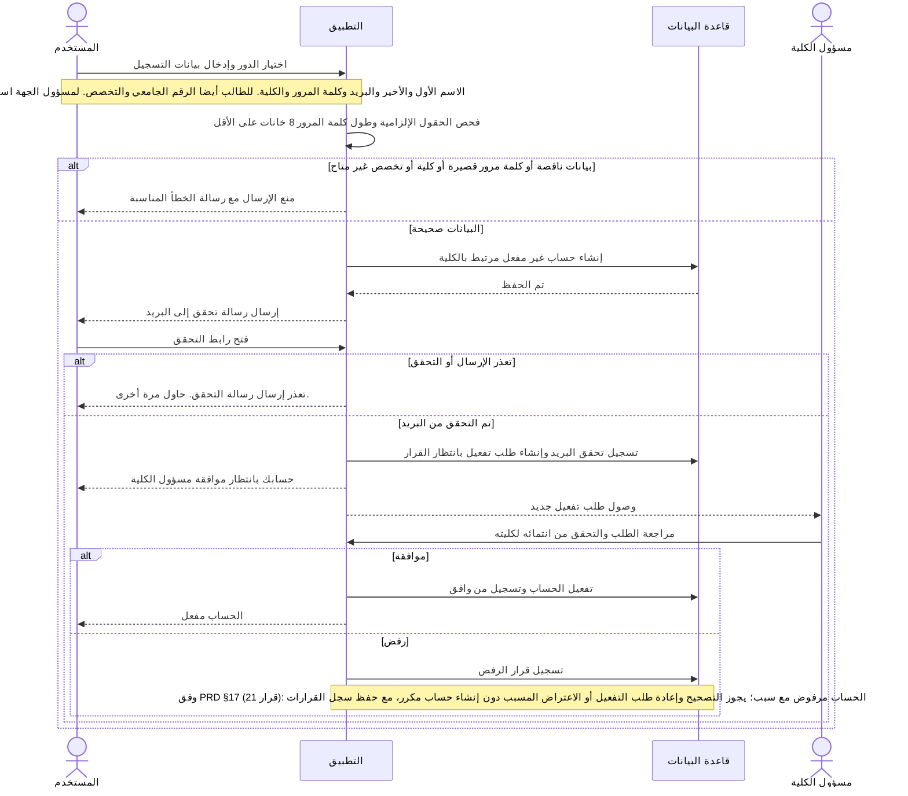
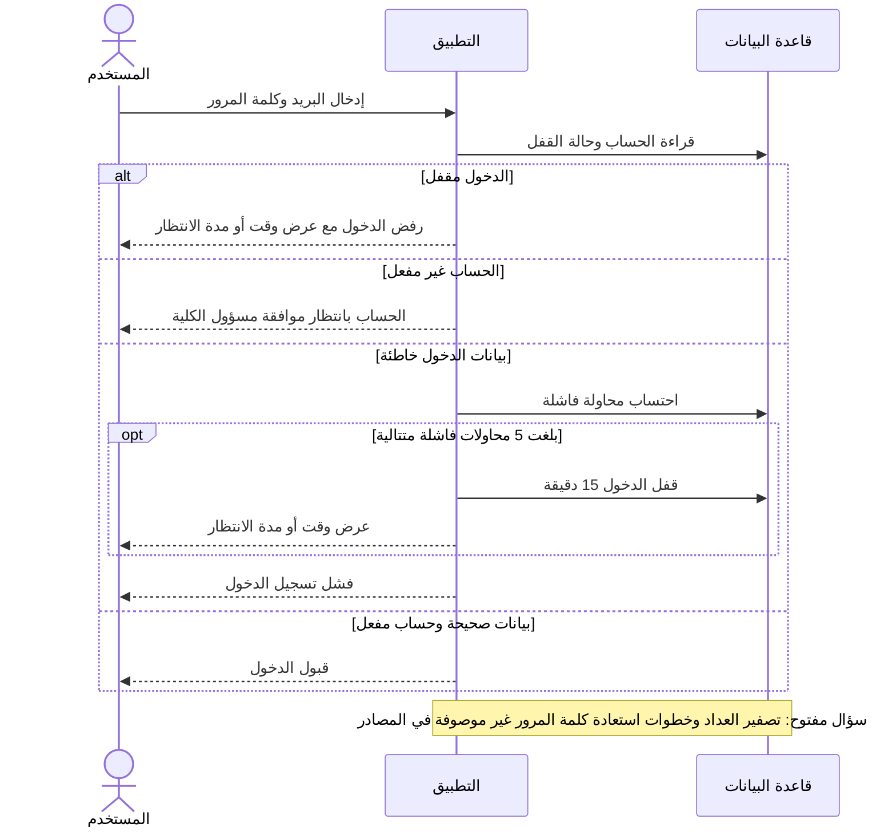
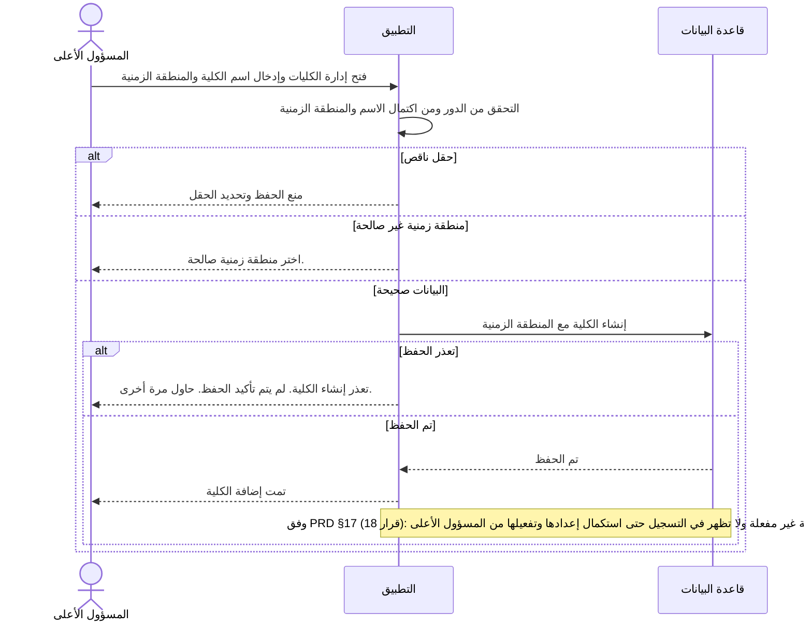
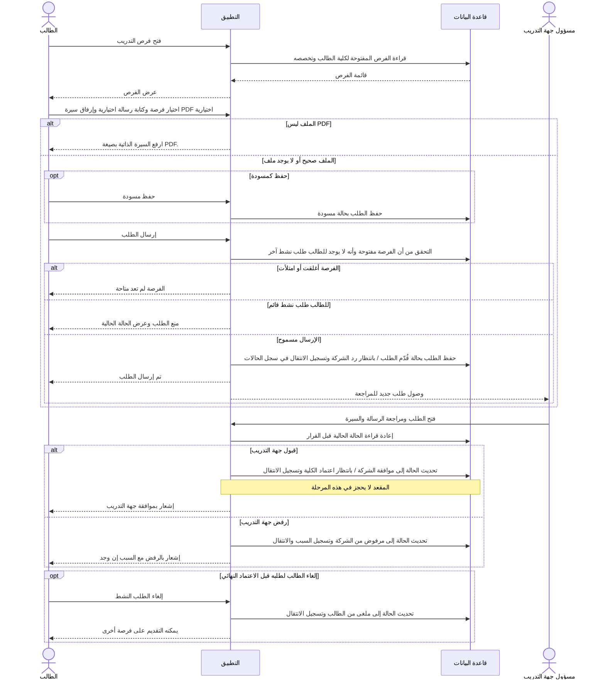
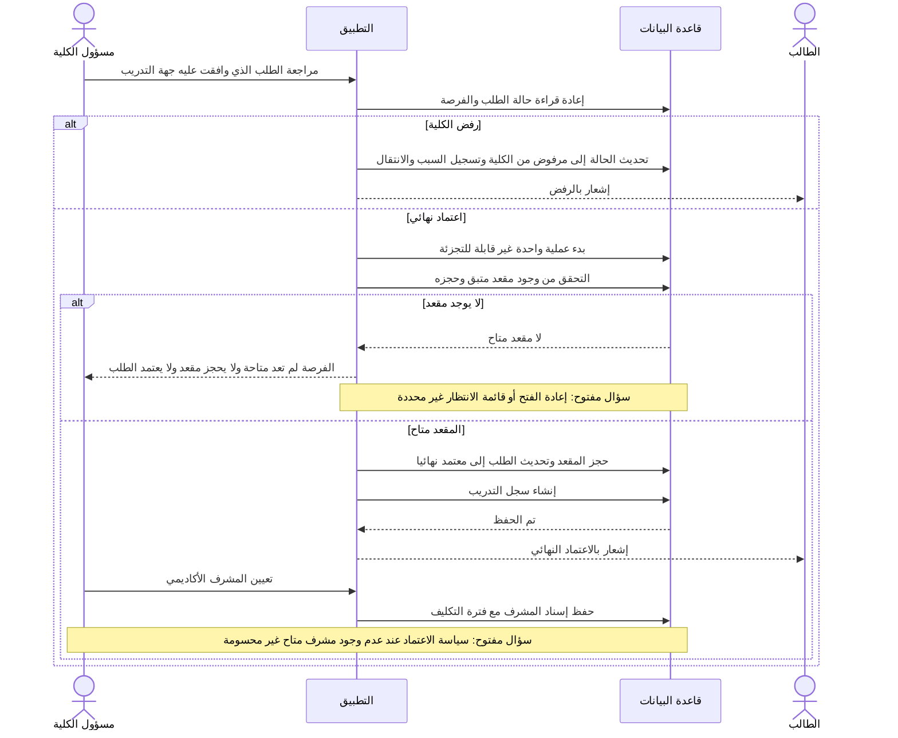
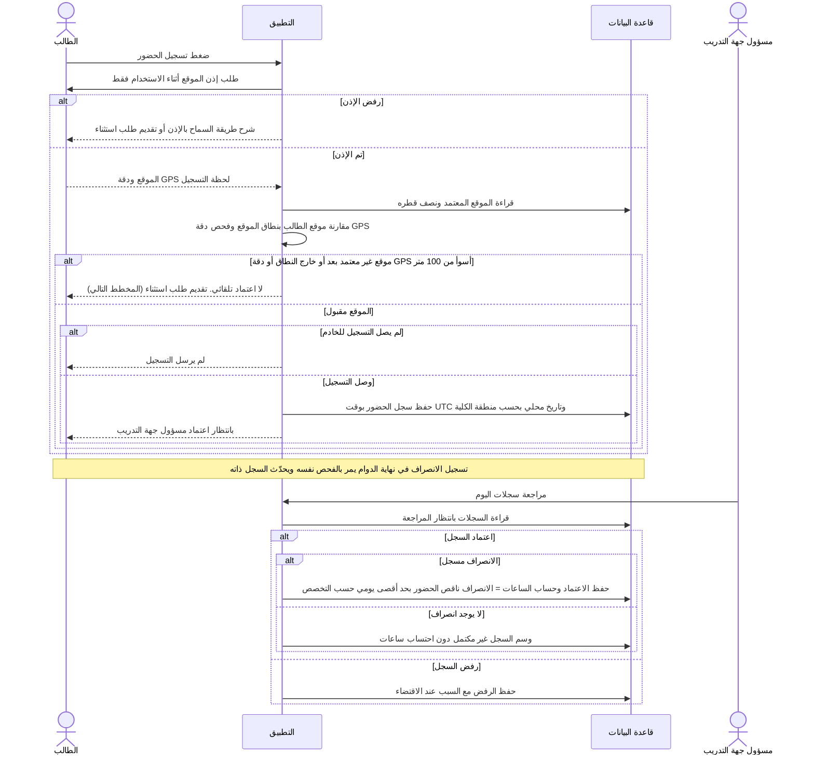
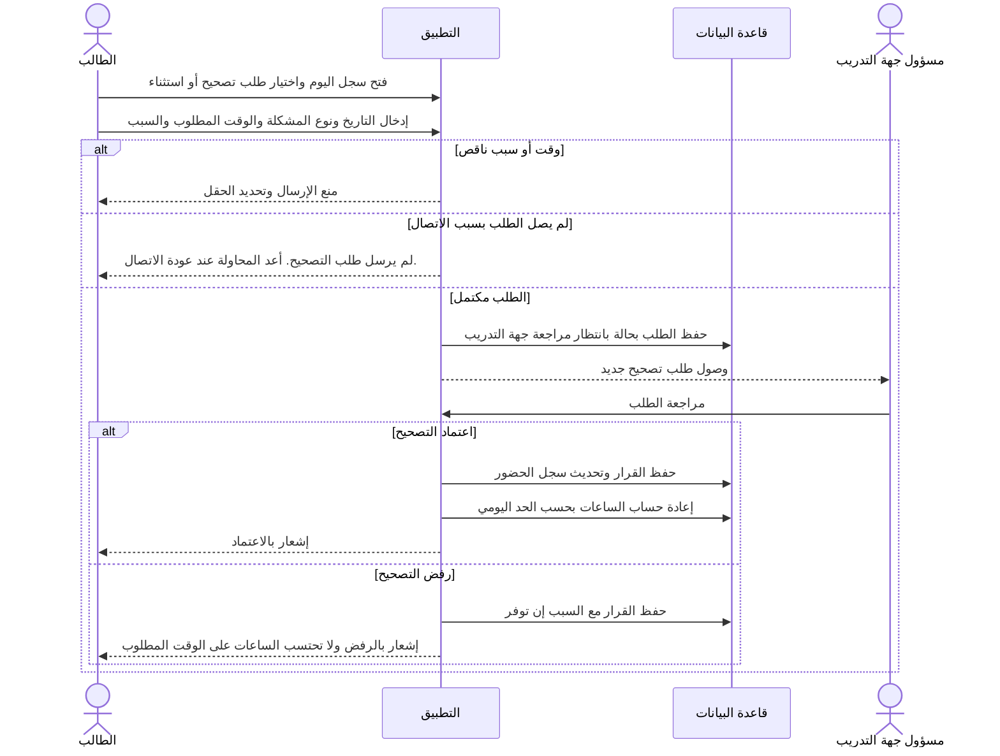
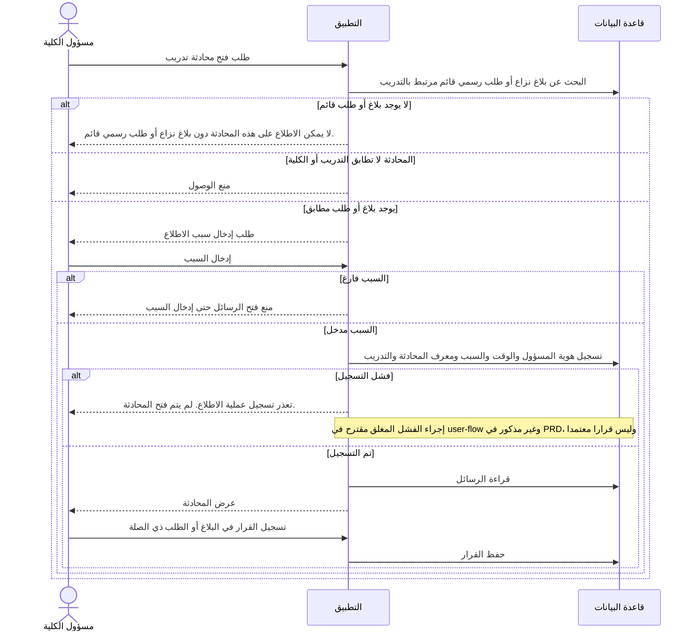
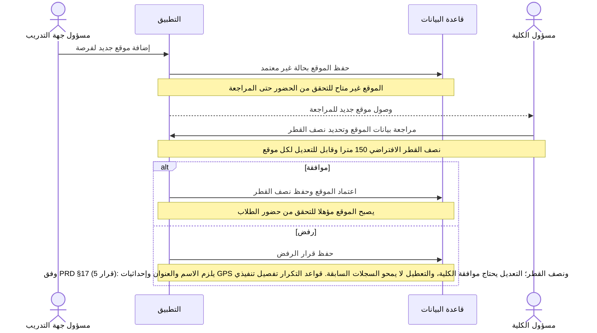
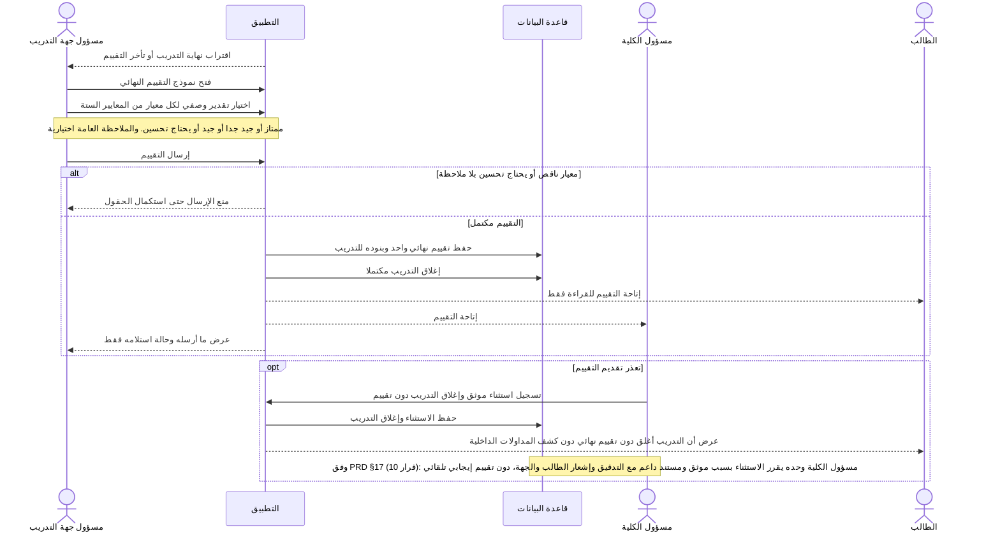

# مخططات تسلسل التفاعلات — نظام إدارة التدريب الميداني الجامعي

**الحالة:** مسودة للمراجعة مع صاحب المشروع.
**الصيغة:** Mermaid `sequenceDiagram`.
**المصادر المستخدمة:** `PRD.md` (المرجع الحاكم) ثم `docs/user-flow.md` و`docs/SRS` (FR-01..FR-07) و`docs/ERD.md` و`docs/diagrams/domain-model.md`.
**ملاحظة:** لا يوجد في هذه المسودة أي سلوك غير مذكور في المصادر. ما لم تحسمه المصادر مكتوب كـ «سؤال مفتوح» داخل المخطط أو في آخر الملف. أسماء حالات الطلب مطابقة لـ PRD §10.1.

**المشاركون المنطقيون في كل المخططات:**
- **التطبيق:** الواجهة والخادم معًا.
- **قاعدة البيانات:** مخزن البيانات (PostgreSQL حسب ERD).
- **الفواعل:** الطالب، المشرف الأكاديمي، مسؤول جهة التدريب، مسؤول الكلية، المسؤول الأعلى.

---

## 1. التسجيل الذاتي وتحقق البريد وتفعيل الحساب

**المصدر:** user-flow §1.1 و§2.1 و§3.1، وSRS-01 إلى SRS-04 وSRS-08.

---

## 2. تسجيل الدخول وقفل المحاولات الفاشلة

**المصدر:** user-flow §1.1، وSRS-05.

---

## 3. إضافة كلية وضبط المنطقة الزمنية

**المصدر:** user-flow §5.1، وSRS-06 وSRS-09.

---

## 4. تقديم طلب التدريب ومراجعة جهة التدريب

**المصدر:** user-flow §1.2 و§1.3 و§3.3، وERD (سجل حالات الطلب).

---

## 5. الاعتماد النهائي من الكلية وحجز المقعد وإنشاء التدريب

**المصدر:** user-flow §1.2 و§4.2، وERD (الطلب المعتمد ينشئ تدريبًا واحدًا).

---

## 6. تسجيل الحضور والانصراف واعتماد السجل

**المصدر:** user-flow §1.4 و§3.4 و§4.2، وERD (التاريخ المحلي بحسب منطقة الكلية).

---

## 7. طلب تصحيح أو استثناء للحضور

**المصدر:** user-flow §1.5 و§3.4.

---

## 8. الاطلاع الاستثنائي على محادثة

**المصدر:** user-flow §4.4، وERD (سجل التدقيق).

---

## 9. مراجعة موقع تدريب جديد

**المصدر:** PRD §11.4 والبند 14 من قواعد العمل، وuser-flow §3.2 و§4.2.

---

## 10. التقييم النهائي وإغلاق التدريب

**المصدر:** PRD §11.5 والبنود 18 و19 و22 من قواعد العمل، وuser-flow §1.6 و§3.4 و§4.3.

---

## الأسئلة المفتوحة التي ظهرت أثناء الرسم

1. حُسم رفض الحساب والاعتراض وإعادة طلب التفعيل وفق PRD §17 (قرار 21).
2. تصفير عداد محاولات الدخول وخطوات استعادة كلمة المرور (المخطط 2). غير مذكورة في PRD.
3. حُسم ظهور الكلية وحالة تفعيلها وفق PRD §17 (قرار 18).
4. ما يحدث لطلب قبلته جهة التدريب إذا امتلأت المقاعد قبل قرار الكلية (المخطط 5).
5. سياسة الاعتماد عند غياب مشرف متاح (المخطط 5، وفق user-flow). وسؤال PRD §17 رقم 8 عن إعادة تعيين المشرف لاحقا.
6. حُسم منع تداخل السجلات والسماح بغير المتداخلة وتصحيح السجل المعتمد بتدقيق وفق PRD §17 (قرار 3)؛ تبقى معالجة الأوقات غير المنطقية تفصيلًا تنفيذيًا.
7. حُسمت بيانات الموقع واعتماد التعديل وحفظ السجلات التاريخية وفق PRD §17 (قرار 5).
8. حُسم صاحب قرار استثناء التقييم ومتطلبات التوثيق والإشعار وفق PRD §17 (قرار 10).
9. الفشل المغلق عند تعذر سجل التدقيق (المخطط 8) مقترح في user-flow وليس معتمدا.

## مخططات لم تُرسم بعد

- ملاحظات المشرف وسجل تعديلها.
- طلب تغيير المشرف.
- الطلب الرسمي وإنهاء التدريب مبكرا (PRD §11.8).
- بلاغ النزاع.
